# ED Multitool

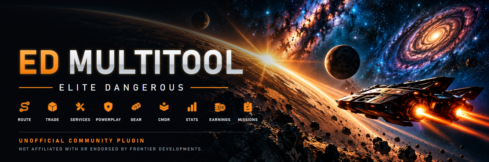

**Your co-pilot for Elite Dangerous, built into [EDMarketConnector](https://github.com/EDCD/EDMarketConnector).**
It always knows where you are, what you fly and how far you can really jump, and turns that into answers:
the richest bodies and biology on your route, the best trade, the nearest service, engineer or Powerplay
system, and where your credits came from. All in one window next to the game. Free, no account, no API key.

<p align="center"><a href="#route">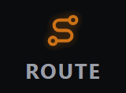</a><a href="#trade">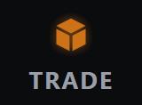</a><a href="#services">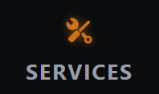</a><a href="#powerplay"></a><a href="#gear">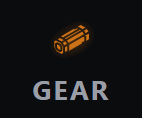</a><a href="#cmdr">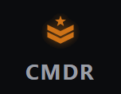</a><a href="#stats">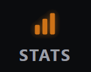</a><a href="#earnings"></a><a href="#missions">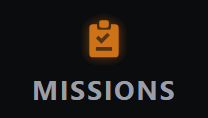</a></p>

**[Install](#install)** · **[What it does](#what-it-does)** · **[Using it](#using-it)** ·
**[Privacy](#your-data-and-privacy)** · **[What's new](CHANGELOG.md)**

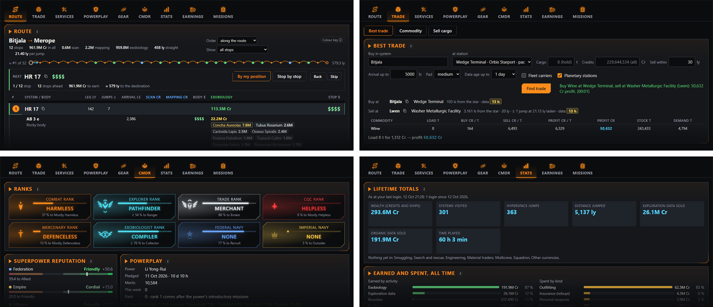

## What it does

Nine tabs, one window:

| | |
|---|---|
| 🧭 **[Route](#route)** | Scout A → B for the stops worth a detour: FSS/DSS bodies, exobiology or both, above *your* minimum values. Follow it jump by jump; what you already mapped or sampled is skipped. On arrival, what this system is worth to you. |
| 📦 **[Trade](#trade)** | The best trade from a station for your hold and credits. The nearest stations that sell or buy a commodity. Where your cargo, mined or bought, sells best. |
| 🛠️ **[Services](#services)** | The nearest station with every service you tick (Material Trader of a kind, Technology Broker, Interstellar Factors, Repair, Black Market…), and the nearest engineer for a module and grade. |
| ⚔️ **[Powerplay](#powerplay)** | For any power, the nearest systems it holds (to reinforce), another power holds (to undermine) or it can acquire, with state, control and what your merits do there. |
| 🎒 **[Gear](#gear)** | Paste a post from the forum's pre-upgraded gear thread: where it is, how far, and how good the offer is. |
| 🎖️ **[CMDR](#cmdr)** | Every rank with its emblem, superpower reputation, your Powerplay pledge and merits, and how they moved over time; every minor faction that knows you. |
| 📊 **[Stats](#stats)** | The game's lifetime statistics, the numbers sites like Inara show: by activity, earned and spent, and how they grew. Every death and what killed you. |
| 💰 **[Earnings](#earnings)** | Earned and spent this session, today and this week, your balance over time, and the data you carry unsold. |
| 📋 **[Missions](#missions)** | Every open mission: destination, distance, jumps, reward and a live countdown. |

Jumps are counted with your **laden** jump range (current cargo, full tanks), not the best-case number the
game shows, unless you choose otherwise. Across the top, always: your system, ship, jump range, credits and
any warning (wanted, warrant, illegal cargo, fines). Inside EDMC, a small panel shows where you are, your ship
and range, the next stop and what you earned, at a glance.

> **Unofficial.** A fan-made community plugin, not affiliated with, endorsed by or connected to Frontier
> Developments plc. Elite Dangerous, its names and its artwork are © Frontier Developments plc; the pictures
> here were made for this project, not taken from the game.

---

## Install

You need **Windows**, **Elite Dangerous** (Odyssey or Horizons, live galaxy), an internet connection and
**[EDMarketConnector](https://github.com/EDCD/EDMarketConnector/releases/latest)** (EDMC), the free, widely
used companion app. ED Multitool is tested with EDMC **6.1.2**; use the latest release.

1. **Install EDMC** if you do not have it: run the `.msi` from the
   [EDMC releases page](https://github.com/EDCD/EDMarketConnector/releases/latest) and start EDMC once.
2. **Download** `ED-Multitool-<version>.zip` from the
   [latest release](https://github.com/Martin8O/ED-Multitool/releases/latest).
3. **Open EDMC's plugins folder:** in EDMC, **File → Settings → Plugins → Open Plugins Folder**
   (usually `%LOCALAPPDATA%\EDMarketConnector\plugins`).

   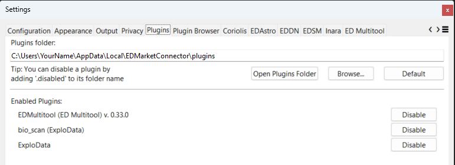

4. **Unzip** the file into that folder, so that `plugins\EDMultitool\load.py` exists:

   ```
   plugins\
   └── EDMultitool\
       ├── load.py
       └── edmultitool\
   ```

   > ⚠️ If Windows made an extra folder level (`plugins\ED-Multitool-<version>\EDMultitool\…`), move
   > `EDMultitool` up so it sits directly in `plugins`.

5. **Restart EDMC** (close it completely). *EDMultitool (ED Multitool)* now shows under **Enabled Plugins**.

**Start EDMC before the game.** If you start it later, EDMC knows some things only roughly until they next
change: your hold, for one, is just tonnes per commodity, so **Sell cargo** counts mission cargo and stolen
goods as yours until then (the card says so while it lasts).

## First start

A new **ED Multitool** section appears in EDMC's main window:

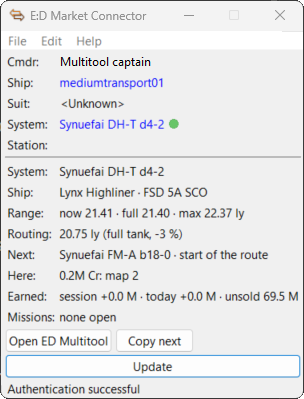

| Line | What it shows |
|---|---|
| **System · Ship** | Where you are (or "game closed · last in …"), your ship and its frame shift drive |
| **Range · Routing** | Your jump range now, with full tanks and at most; the range routes are planned with |
| **Next** | The next system on your route |
| **Here** | What the system you are in is worth to you |
| **Earned · Missions** | Net credits this session and today, data still unsold; open missions, their reward and the next to end |

**Open ED Multitool** opens the big window (its own window in Edge, Chrome or Brave, otherwise a tab in your normal browser).
**Copy next** copies the next system's name for the galaxy map (`Ctrl+V`). The window updates by itself while
you play: keep it on a second screen.

Across the top it always shows your system, ship, jump range and credits. **Warnings** appear there only when
there is one: wanted or hostile here, a warrant, illegal cargo, speeding, notoriety, unpaid fines or bounties
(hover for which faction and how much; fines and bounties count since your ship was last destroyed). Top
right: the **sun / moon** switches between the dark and the light look, the yellow **(i)** shows the version,
what's new, the data sources and the credits. Every card has an **(i)** that explains it.

## Using it

One chapter per tab, in the order they sit in the window.

<a name="route"></a>

## 🧭 Route

> **Scout A → B for the bodies and biology worth a detour, then follow it jump by jump.**

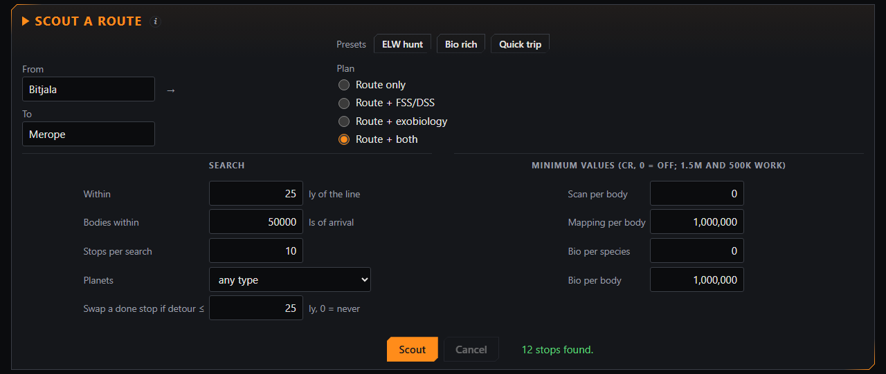

1. **From** follows the system you are in unless you type another; **To** follows the route you fly (the one
   plotted in the galaxy map, else the route you follow) unless you type one. Both suggest names.
2. **Plan:** route only, + FSS/DSS (Earth-likes, water worlds, terraformables…), + exobiology, or + both.
3. Fine-tune or pick a **preset** (*ELW hunt*, *Bio rich*, *Quick trip*): how far off the line a stop may be,
   how far from the arrival star a body may be, stops per search, planet types, and **minimum values** per
   body and species (`1.5M` and `500k` work, `0` = off). **Swap a done stop if detour ≤ … ly** replaces a stop
   you have already finished with a fresh one when that costs at most that many light years.
4. **Scout.** Each stop lists its bodies with arrival distance, scan, mapping and biology value; `$` to
   `$$$$$` rate them at a glance (**Colour key** explains the colours). Sort along the route or most valuable
   first, and hide what you do not need.

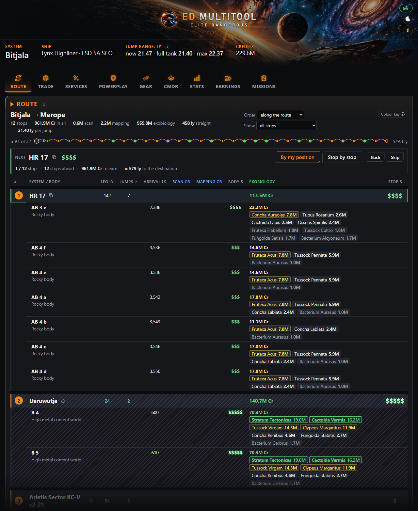

A **strip** above the list draws the route like the game does: one mark per jump, the stops coloured by what
they offer (green exobiology, blue FSS/DSS), what is behind you dimmed; long routes turn into ticks, then a line.
The **Next** box follows you as you jump: **By my position** counts the stops you fly past without visiting
as behind you, **Stop by stop** waits until you arrive in the next one; **Back** / **Skip** by hand, copy button
for the galaxy map. Plotted a route in the galaxy map yourself? **Follow it** takes it over. Bodies you mapped and
species you analysed are read from your journals and never counted twice.

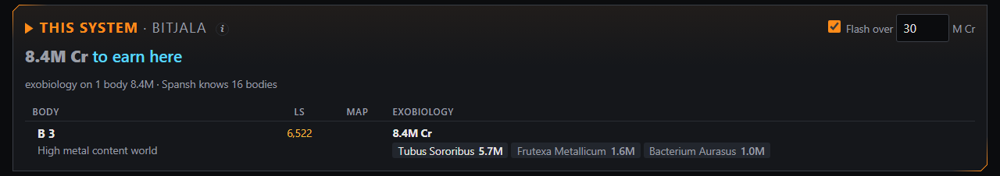

**This system** tells you, the moment you arrive, what is worth mapping or sampling here (with your minimum
values, without what you already did), life nobody has sampled yet, and *first discovery possible* when nobody
has been there. It grows as you scan. **Flash over … M Cr** flashes the window when one body is worth at least that.

<a name="trade"></a>

## 📦 Trade

> **What to buy, where to sell it, and where your cargo pays the most.**

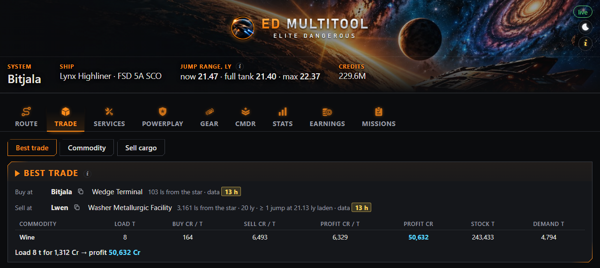

Three views at the top:

- **Best trade:** what to buy at a station (your last dock, or pick a system and station) and where to sell it
  for the most profit. Empty **Cargo** / **Credits** = your whole hold and balance. Set how far the buyer may be,
  arrival distance, pad, data age, fleet carriers and planetary stations. You get both stations, distance and
  jumps laden, and per commodity the tonnes, prices and profit. (Spansh's trade router knows only whether a
  station has a large pad: with a smaller ship a surface settlement may still lack yours.)
- **Commodity:** the nearest stations that **sell** or **buy** it, with price, stock or demand, pad, arrival
  distance, your standing with the station's faction and a **data age** badge (green under an hour, red over two
  days). Fleet carriers are off by default; stations that would refuse you docking are hidden.
- **Sell cargo:** your hold line by line and, after **Find buyers**, the three best payers for each commodity
  within reach that take all you carry, plus the **one stop** that buys everything (and a richer partial stop,
  to weigh one stop against two). Mission cargo, stolen goods and limpets are shown, not searched. What you
  mined this session is marked, with tonnes and tonnes per hour.

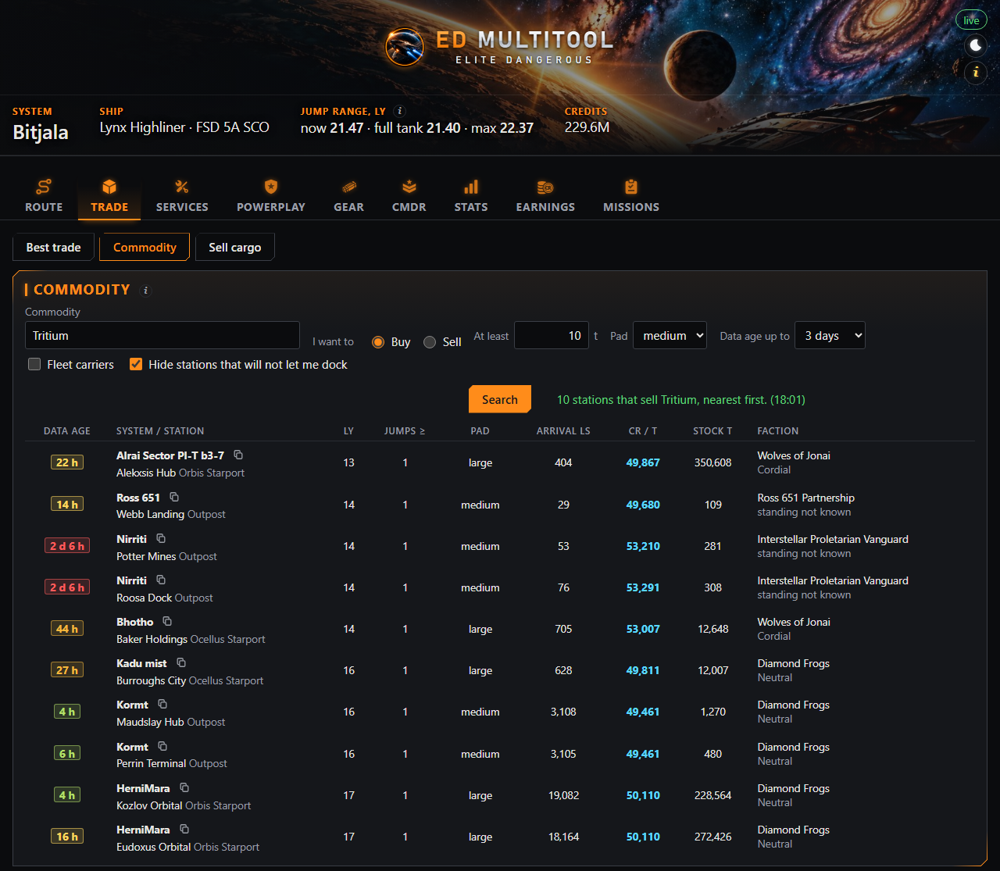

<a name="services"></a>

## 🛠️ Services

> **The nearest station with every service you need, or the nearest engineer.**

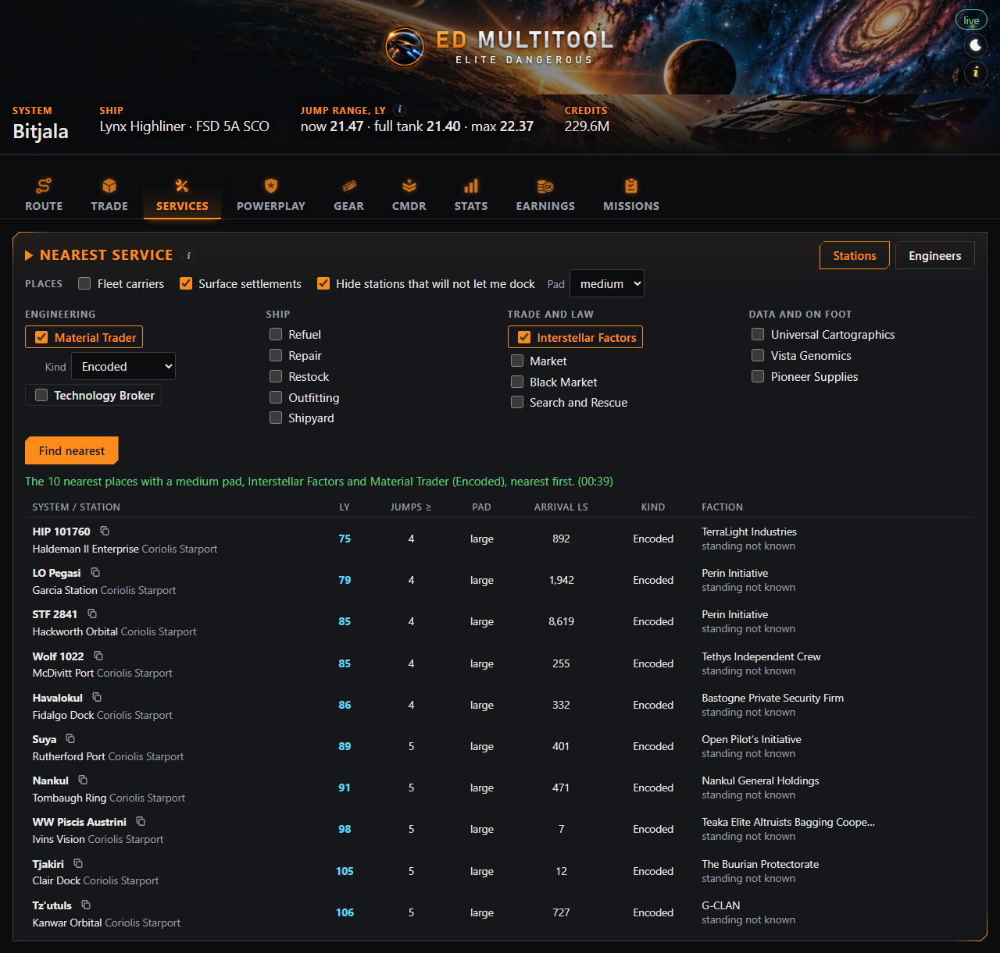

**Stations**: tick the services the station must have, grouped as Engineering (**Material Trader**,
**Technology Broker**), Ship (Refuel, Repair, Restock, Outfitting, Shipyard), Trade and law
(**Interstellar Factors**, Market, Black Market, Search and Rescue) and Data and on foot (Universal
Cartographics, Vista Genomics, Pioneer Supplies), and press **Find nearest**: the 10 nearest places your ship
can land at with every one of them, with your standing with each station's faction. Nothing ticked finds any
station. A Material Trader can be asked for by kind (raw, manufactured, encoded) and a broker as human or
Guardian. **Places** decides what counts: fleet carriers, surface settlements, and whether stations that would
refuse you docking are hidden.

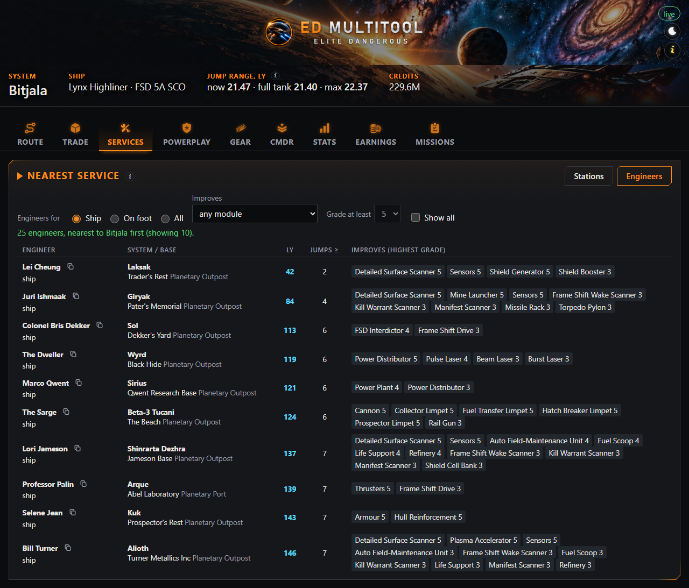

**Engineers** (the switch at the top of the card): ship, on foot or all, optionally for one module and a lowest
grade. Nearest first, with
everything each one improves. The list is built in and works offline; an engineer works for you only once
unlocked in the game.

<a name="powerplay"></a>

## ⚔️ Powerplay

> **The nearest systems to reinforce, undermine or acquire for a power, and what your merits do there.**

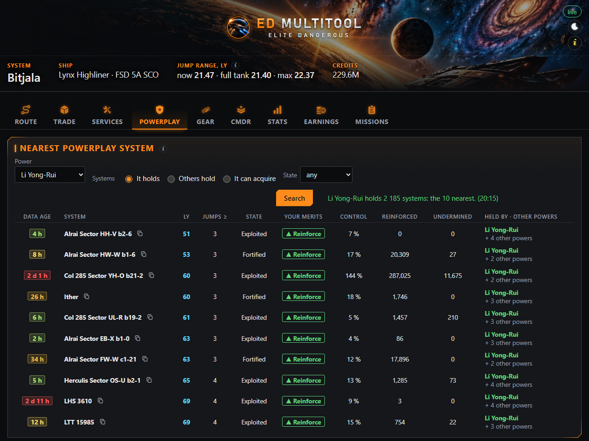

Pick a power (yours comes first) and one of three questions, one per merit activity:

- **It holds:** the power's own systems (Exploited, Fortified, Stronghold), where your merits reinforce.
- **Others hold:** another power's systems where this one is present too, where your merits undermine.
- **It can acquire:** Unoccupied systems in the power's reach, where your merits help it take them.

Optionally one state. For each system: state, control, this cycle's reinforcement and undermining, and **what
your merits do there**: ▲ Reinforce, ▼ Undermine, ✚ Acquire or – Out of reach. The line above the list says how
many systems match, and when even the nearest is far away, how far.

<a name="gear"></a>

## 🎒 Gear

> **Decode a pre-upgraded gear post: where it is, how far, and how good the offer is.**

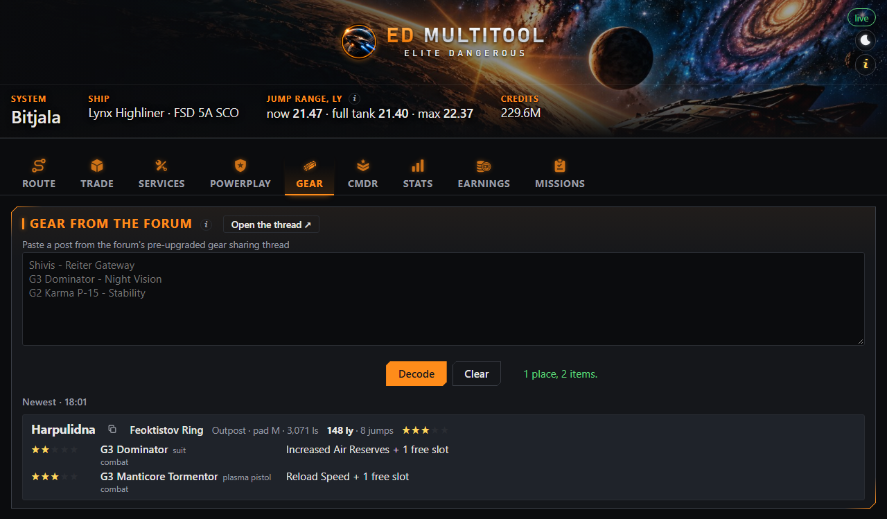

**Open the thread** opens the newest posts of the Frontier forum's *pre-upgraded gear sharing* thread. Copy a
post, paste it, **Decode**: the station, distance and jumps, each item with its modifications, and a ★ rating
of the offer (hover for why). Your last three finds stay to compare. Nothing is posted, and the forum is never
read in the background.

<a name="cmdr"></a>

## 🎖️ CMDR

> **Your ranks, reputation and Powerplay standing, and how they moved over time.**

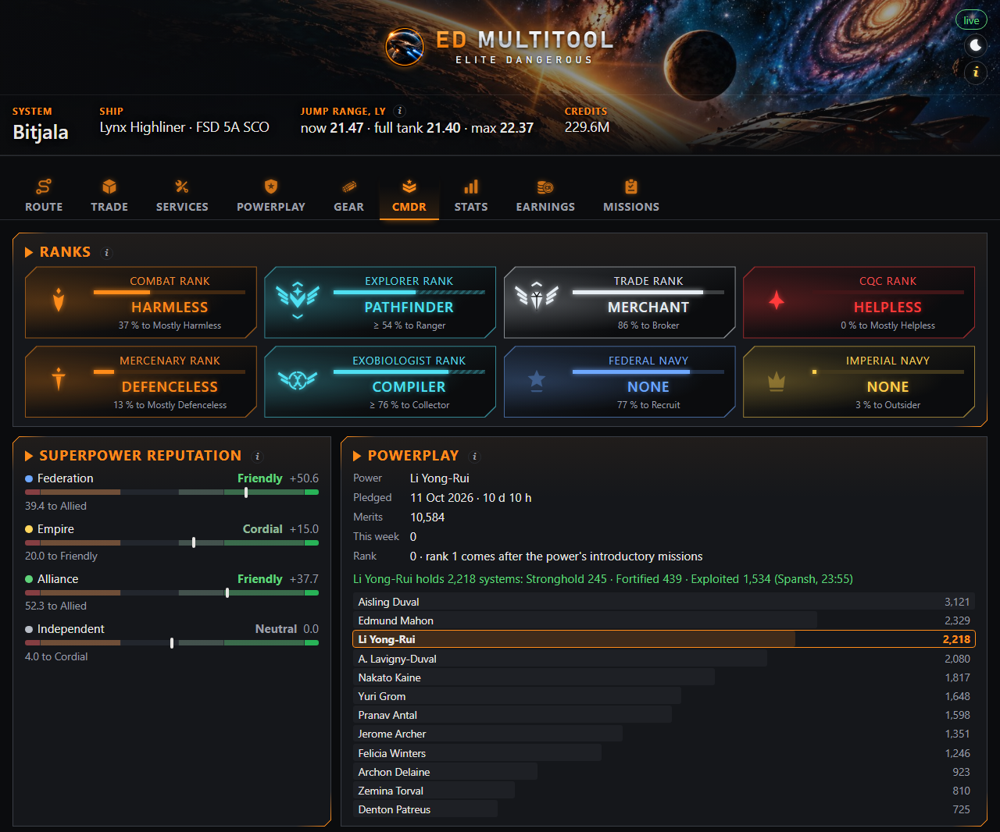

From your journals, nothing to fill in: all eight ranks (Combat, Explorer, Trade, CQC, Mercenary,
Exobiologist, Federal and Imperial Navy) with the percent to the next (marked ≥ after a promotion or a sale, until
your next login tells the new one) and an emblem that grows with the rank;
Federation, Empire, Alliance and Independent reputation (−100 … +100, with the game's word for it); your
Powerplay pledge, merits in all and this week (from Thursday 07:00 UTC), your rank and how many systems your
power holds; and all of it over time.

**Minor factions**: every faction you have a standing with, best first: the game's word and number, missions
completed for it, its state when you last met it (war, boom, election…), where and when, and the nearest system
you have seen it in (from your own journals). Arrive where a faction holds you Hostile and the EDMC panel warns
you: its stations will refuse you.

<a name="stats"></a>

## 📊 Stats

> **The game's lifetime statistics, by activity and login by login.**

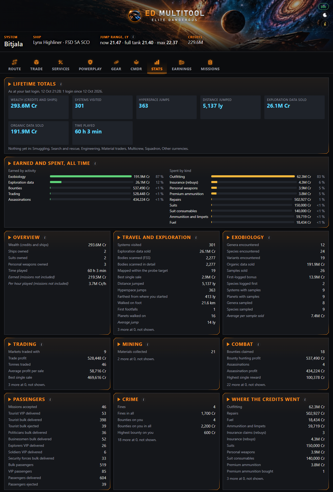

The lifetime statistics the game writes at every login, offline: the big totals, what each grew by in the last
week, and a small chart of each over your logins; earned and spent by kind; a card per activity (exploration, exobiology,
trading, combat, passengers, crime…) with every figure that is not 0 and a few worked out from them (average
jump, credits per hour played). **Deaths**: every one in your journals (the game's totals count none), who
killed you and what coming back cost.

<a name="earnings"></a>

## 💰 Earnings

> **Where your credits came from and went, and what you still carry unsold.**

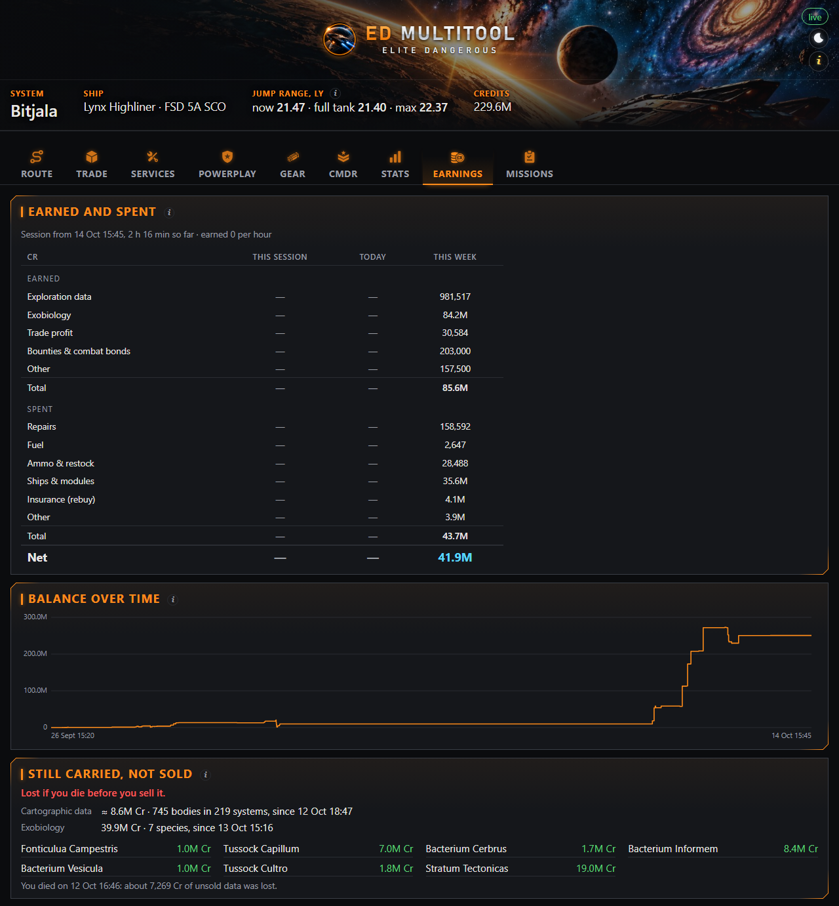

From your journals: **earned and spent** this session, today and this week (from Monday) by kind, with credits
per hour; your **balance over time**, exact at every login and followed through every credit in between; and
what you **still carry unsold**, cartographic data (an estimate with first-discovery and mapping bonuses) and
species since your last Vista Genomics sale (five times the value where you were the first to set foot on the
body). All of it is lost if you die before you sell it. Beside what was paid, in grey, each column shows what
you gathered in that period and have not sold yet; the top row shows the whole unsold amount next to your credits.

<a name="missions"></a>

## 📋 Missions

> **Every open mission with distance, reward and a live countdown.**

Every open mission: what it is, who gave it, where it sends you (copy with one click), distance and jumps at
your routing range, the reward, and the time left counting down (red under 2 hours). Sort by time left or
distance. A finished mission says where to hand it in. Each login, the game's own list sets it straight.

## Settings

In EDMC: **File → Settings → ED Multitool**.

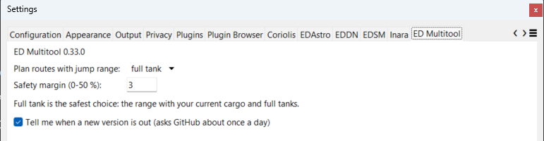

- **Plan routes with jump range:** *full tank* (current cargo, full tanks) is the safest; *current fuel &
  cargo* is the range right now, *best case (empty)* the most your ship can ever jump.
- **Safety margin (0–50 %):** plan with that much less range, to keep a reserve, for example for cargo you pick
  up on the way.
- **Tell me when a new version is out:** about once a day ED Multitool asks GitHub for the newest version and,
  if there is one, shows a clickable line in its panel in EDMC's main window and a strip at the top of the page,
  both leading to the release page. It never downloads or installs anything. The same switch is in the page's
  footer.

Your installed version shows in this tab, in EDMC's Plugins tab and at the bottom right of the window.

## Update or remove

- **Update:** close EDMC, unzip the new version over the old one, start EDMC. Settings, fleet and exploration
  history stay.
- **Remove:** close EDMC and delete the `EDMultitool` folder from the plugins folder, with everything it
  remembered (your browser keeps only a few view choices, such as the open tab).

## Your data and privacy

- The window is served by EDMC on your own computer only (`127.0.0.1`): nobody on your network or the internet
  can open it.
- ED Multitool **reads** your game journals (the files EDMC already reads) and never changes them.
- What it remembers (settings, your fleet, what you explored) stays in the `data` folder inside `EDMultitool`;
  the page keeps a few view choices, such as the open tab, in your browser.
- Online it asks [Spansh](https://spansh.co.uk) and [Ardent Insight](https://ardent-insight.com) about
  **systems, stations and markets**: the ones you search from or for, the system you arrive in (to tell you
  what it is worth) and your missions' destinations. GitHub is asked about once a day for the newest version
  number (you can turn that off). Your commander name and account are never sent.

## Troubleshooting

| What you see | What to do |
|---|---|
| No ED Multitool section in EDMC | `plugins\EDMultitool\load.py` must exist (no extra folder level). Restart EDMC. |
| "Port 47615 is busy" in the panel | Usually a second EDMC: close every EDMC and start one. Until then the page works at the address the panel shows. |
| **Open ED Multitool** greyed out | The page could not start: see EDMC's log (last row). |
| "No browser could be opened" | Open the address the panel shows (normally `http://127.0.0.1:47615/`) in any browser. |
| A card says Spansh or Ardent cannot be reached | The service is down or busy; try later. The rest keeps working. |
| **Sell cargo** counts mission cargo or stolen goods as yours | EDMC started after the game. Mine, buy, sell or collect anything (or restart the game). |
| Something else | [Open an issue](https://github.com/Martin8O/ED-Multitool/issues) and attach EDMC's log, `%LOCALAPPDATA%\EDMarketConnector\logs\EDMarketConnector-debug.log`. |

## Credits

- Galaxy, route, market, station and Powerplay data: [Spansh](https://spansh.co.uk), with
  [Ardent Insight](https://ardent-insight.com) as the market backup. Thank you both for running these
  services for the community; ED Multitool asks politely (at most one question a second).
- [EDMarketConnector](https://github.com/EDCD/EDMarketConnector) and the [EDCD](https://github.com/EDCD)
  community data ([FDevIDs](https://github.com/EDCD/FDevIDs)) for the engineer list.
- Elite Dangerous is © Frontier Developments plc. ED Multitool is an unofficial, fan-made tool, not affiliated
  with or endorsed by Frontier Developments.

Ideas and bug reports are welcome as [GitHub issues](https://github.com/Martin8O/ED-Multitool/issues).
ED Multitool is free software under the [MIT licence](LICENSE).

---

<details>
<summary>For developers</summary>

Plain Python 3.13 (EDMC's own), no build step; the window is plain HTML/JS/CSS served from the plugin.
Design: [docs/architecture.md](docs/architecture.md) · the Spansh/Ardent request shapes we rely on:
[docs/api-notes.md](docs/api-notes.md). The toolchain needs [uv](https://docs.astral.sh/uv/); it keeps Python,
the virtual environment and its caches inside the project folder.

- Quality gate (lint, types, tests): `powershell -NoProfile -File tools/gate.ps1`
- Release zip: `.venv/Scripts/python tools/make_release.py` → `dist/ED-Multitool-<version>.zip`
- Run without EDMC, replaying a journal: `.venv/Scripts/python tools/devrun.py`

</details>
